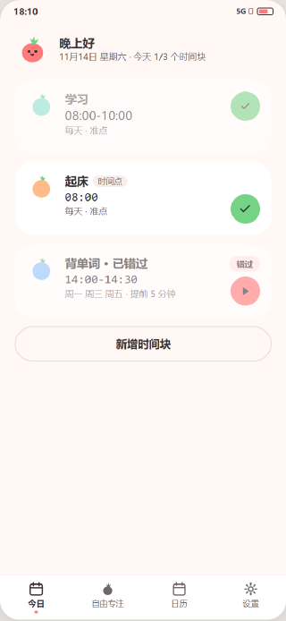
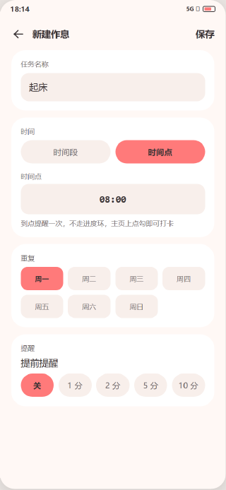
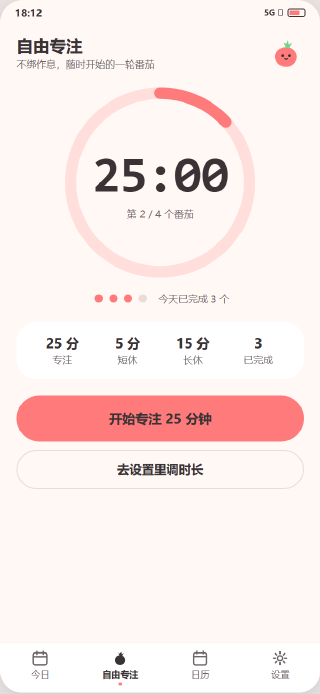
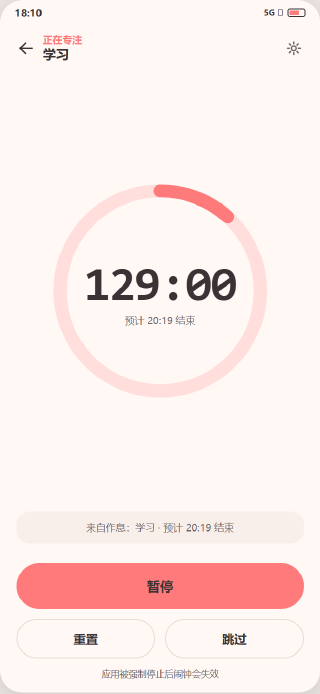
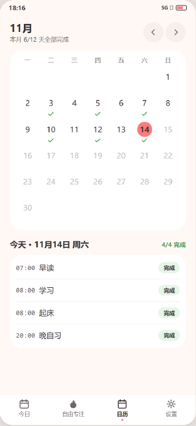
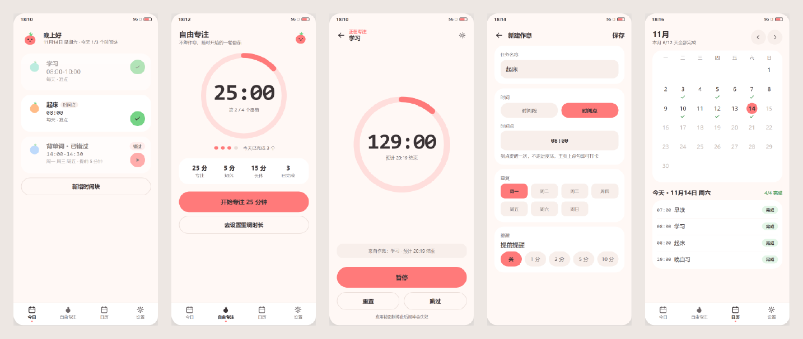

# FocusBlock

按作息表提醒的番茄钟。到点弹通知、锁屏也响，做完打卡；没设作息表就是个普通番茄钟。

纯离线——不申请网络权限，没有账号、没有云同步，数据只存在手机本地。

- 版本 1.7.7（versionCode 24）
- minSdk 30（Android 11）/ targetSdk 35 / compileSdk 35
- 包名 `io.github.xiaoxia.focusblock`
- Kotlin + Jetpack Compose + Material 3，不引 Room，存档是一份 JSON 存 DataStore

## 功能

| 预览 | 说明 |
| :--: | :-- |
|  | **时间块**　按作息表建块（早读 07:00–07:40、晚自习 19:00–21:00……）。到开场时间提醒「该开始了」，到结束时间提醒「该收尾了」，通知上直接有「开始 / 结束」按钮，不用进 App。做完的块变灰，超时的挂标签，一眼看出今天还剩什么。 |
|  | **时间点**　只提醒一次，比如 8:00 起床。编辑时「时间段 / 时间点」二选一，时间点只有一个时间框；没到点按钮是灰锁，打卡直接落一条完成，不走进度环。 |
|  | **自由专注**　不绑作息表的番茄钟。25 分钟专注 / 5 分钟休息，4 轮后长休息，时长在设置里改。今天做了几个番茄、累计多久，页面上直接看得到。 |
|  | **番茄计时**　圆环 + 大数字倒计时，数字按可用宽度自动缩放，`129:00` 这种六位数不会折行。切后台、锁屏照样到点响，回来记账不重复。 |
|  | **日历**　按月看，某天计划块全做完才有勾。点某一天展开当天明细（时间 / 标题 / 状态）。 |

**权限自检**　精确闹钟、通知、电池优化、厂商后台开关逐条查，橙色就是没开。附小米 / 华为 / OPPO / vivo / 荣耀 / 三星的具体路径。

深色模式齐全，所有文字对比度 ≥ 4.5:1。

## 构建

用 Android Studio 打开本目录即可，命令行：

```bash
./gradlew :app:assembleDebug
# 产物：app/build/outputs/apk/debug/app-debug.apk
```

需要 JDK 17、Android SDK Platform 35、Build-Tools 35.0.0。`local.properties` 里的 `sdk.dir` 指向本机 SDK（这个文件不进仓库）。

单测 87 条，纯逻辑、不碰界面：

```bash
./gradlew :app:testDebugUnitTest
```

## 项目结构

| 页面 | 文件 |
| --- | --- |
| 今日主页（含底部 Tab） | `ui/screens/TodayScreen.kt` |
| 自由专注 | `ui/screens/FreeFocusScreen.kt` |
| 时间块编辑 | `ui/screens/EditorScreen.kt` |
| 番茄计时 | `ui/screens/TimerScreen.kt` |
| 权限自检 | `ui/screens/PermissionsScreen.kt` |
| 日历 | `ui/screens/HistoryScreen.kt` |
| 设置 | `ui/screens/SettingsScreen.kt` |
| 使用说明 | `ui/screens/GuideScreen.kt` |

几个关键位置：

- `domain/Scheduler.kt`　闹钟排布，排未来 48 小时，开机 / 每天 00:05 / 改表后各重排一次
- `domain/Missed.kt`　场次时刻计算、超时判定、归天规则
- `domain/BlockFlow.kt`　开始 / 结束 / 打卡的状态流转
- `notify/`　通知与各个接收器
- `data/Models.kt`　数据模型与排序
- `ui/components/AutoFitText.kt`　倒计时按可用宽度实测缩放，`129:00` 不会换行

底部四个 Tab：今日 / 自由专注 / 日历 / 设置。

## 图标

应用图标用 `branding/icon-source.jpg` 里的番茄画稿做的：

- 自适应图标走两层：`@color/ic_launcher_background`（奶油底 #FDF9ED）+ `mipmap-*/ic_launcher_foreground.png`（去底番茄，占 108dp 画布 90%，圆形遮罩下星星不会被切）
- 8.0 以下走 `mipmap-*/ic_launcher.png` 与 `ic_launcher_round.png`
- 原始画稿和抠好的透明版本都留在 `branding/`，换图重出时以 `icon-artwork.png` 为母版

## 已知限制

- **时间块是打卡式，不是倒计时**：进计时页不会自动倒数到块结束，要点开始、点结束。要改成倒计时得动实现口径。
- **「已结束」按设定时刻，不顺延**：18:50 才点开始，19:00 照样挂「已结束」，只做十分钟也算结束。
- **超时标签不会自己消**：迟到补做以后标签仍在，那天不打勾，也没有单条撤销入口。
- **宽限 5 分钟，不含 5 分钟整**：到点 0～4:59 补点都算按时，满 5 分钟才落超时。时间段最短也是 5 分钟，两个数绑在一起；23:55 之后放不下一段 5 分钟，只能设时间点。
- **不能跨天**：22:30–06:30 这种建不出来，要拆成两块。域逻辑里还留着跨天分支，只是入口禁了。
- **铃声只有全局一份**：所有块共用设置页那一个铃声，做不到每块不同。
- **冷启动有一小段开屏**：读盘几十到几百毫秒，这期间只有底色 + 吉祥物；低端机可能到半秒。
- **没有内置中文字体**：倒计时用系统等宽字体，省掉 8～12 MB 包体。
- **页面文案没全走 `strings.xml`**：通知相关在资源里，页面文案目前在 Compose 里直接写中文，做多语言得先补这一步。
- **通知标题行是软件名**：部分系统会在通知最上面再显示一遍 App 名，可能出现两个 `FocusBlock`（小米 / HyperOS 上不会）。要彻底避免得换自定义 RemoteViews。

## 版本历史

完整历史见 [CHANGELOG.md](CHANGELOG.md)（24 个版本，最新在上）。挑几个节点：

- **1.7.7**　补回 `DailyReceiver` 的清单注册。之前每天 00:05 的重排广播送不到，闹钟只排 48 小时，连续两天不开 App 提醒就全哑了。
- **1.7.0**　禁跨天块；同一时刻的块拆成多条通知；番茄钟接上系统闹钟，切后台也能响；说明书重写。
- **1.5.0**　「超时」从状态改成标签，日历按「那天有没有超时」决定打不打勾。
- **1.3.0**　补上「过了点的新块」判超时；底部导航改成实心药丸，能一眼看出在哪一栏。
- **1.1.0**　历史页改成日历；做完的块变灰。
- **1.0.0**　第一版：时间块 + 自由专注 + 权限自检，按 `FocusBlock-开发规格v3.md` 落地。

## 全局预览

五个主页面从左到右：今日主页、自由专注、番茄计时、时间块编辑、日历。深色模式是同一套布局换色。



## 协议

MIT，见 [LICENSE](LICENSE)。
